<div align="center">
  
  <h1>MyTutor</h1>
</div>

私人编程学习平台 · AI 微课 + 动手判题 + 自动笔记。当前版本 **v0.7.1**。

一次只学一个微知识点：讲一小段（只讲课程里最小的这一个点 + 一个示例）→ 马上动手做小题 → 错了给提示不给答案 → 改对再做一道变式题巩固 → 你点「下一个」才前进。小节有小总结，模块有大总结。反对知识灌输：锁的是「最小知识点范围」而非字数，讲解以零基础教学路径为主线、官方文档作事实校验。

基于开源项目 [HKUDS/DeepTutor](https://github.com/HKUDS/DeepTutor)（Apache-2.0）构建：保留其知识库 / RAG / 文档抓取 / 代码沙箱引擎，外壳（后端 API、教学循环、前端）全部重写。详见 [致谢与许可](#致谢与许可)。

## 功能

- **微知识点教学循环**：讲解 → 出题 → 纠错（只给方向性提示，绝不给答案）→ 巩固变式 → 用户手动推进；小节 / 模块自动总结。讲解锁定当前最小知识点（不展开相邻/后续点、示例不引入后续语法），示例行数有上限，防灌输。
- **四个语言包**：Python、JavaScript、TypeScript、HTML/CSS。一键安装：自动抓取最新官方文档（Python 官方中文教程、MDN 中文指南、TS 官方手册）→ 建向量索引 → AI 生成三级技能树（模块 / 小节 / 微知识点，共 197 点）。
- **学习书**：技能树目录可折叠，当前点自动定位；进度记录在服务器，换电脑接着学；支持继续学习 / 从头重学；左栏可收纳成窄轨，专注当前内容。首页九张语言卡整张可点，与学习书同一入口语义：已装直接进去学，未装自动装好再进入，安装中可点进去看日志，失败可重试。
- **统一代码区**：Monaco 编辑器（本地打包，不走 CDN）。Python / JS / TS 在沙箱真实运行判题（平台统一判题底座，输出捕获为 `_mt_out`）；HTML 实时预览。纸白 / 夜黑双主题。
- **笔记**：每学完一个点，AI 自动归纳复习笔记——只突出知识点重点（核心一句话 + 2~3 条要点，≤150 字），不记录刷题过程；仅当错误反映对知识点的误解时附一句澄清。小节 / 模块总结自动存档；重学同一点只更新不重复。也可手动记笔记，支持编辑、删除、按语言 / 来源筛选、关键词搜索。
- **国产模型**：DeepSeek（主教学 / 深度推理）+ 阿里百炼 DashScope（Qwen 系列 + 知识库嵌入）。API key 只存服务器本地，接口打码回显，绝不进仓库、绝不发给模型方之外的任何地方。
- **界面**：统一柔和毛玻璃材质（低饱和暖纸色，按 solid-glass 四条规则手写）；代码区另有纸白 / 夜黑主题可切换。
- **单用户安全**：口令登录（scrypt 哈希），HttpOnly cookie 会话 7 天；生产部署走 HTTPS。
- **手机可用 + PWA**：窄屏（≤767px）自动切单栏移动布局——底部四页签、讲解/代码区分段页签、目录右抽屉；手机讲解区卡头随正文一起滚动，把高度让给阅读。桌面布局保持不变。支持"添加到主屏幕"安装为 PWA；Service Worker 只缓存静态资源（绝不缓存 /api），断网仍可打开界面。

## 界面预览

> 以下为本地演示数据截图（mock 模型 / 沙箱），仅展示界面与交互，不代表真实账号进度。

**桌面 · 三栏同屏**

| 讲解：最小知识点 + 示例 + 示意图 | 出题：动手小题 + 代码区判题 |
| --- | --- |
| 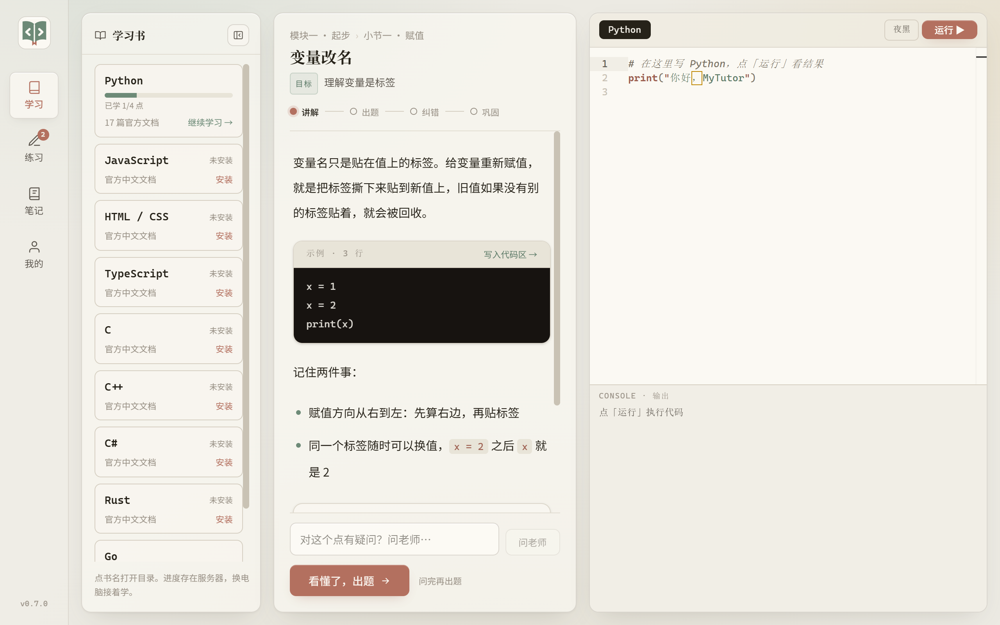 | 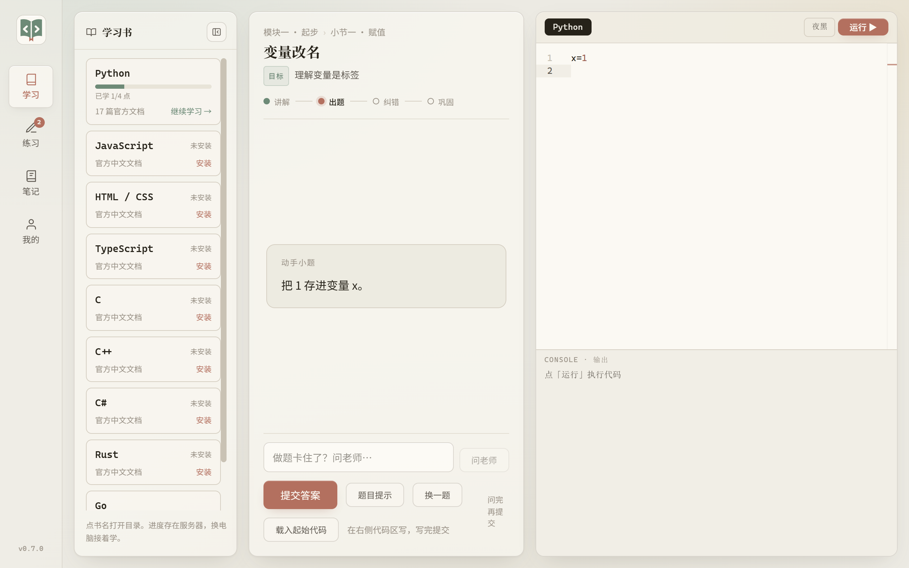 |

| 练习：到期复习 / 错题本 / 统计 | 笔记：AI 自动归纳 + 手动笔记 |
| --- | --- |
| 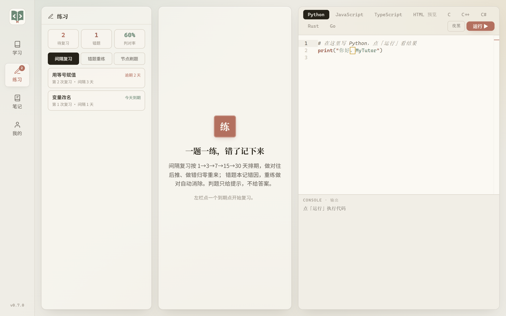 | 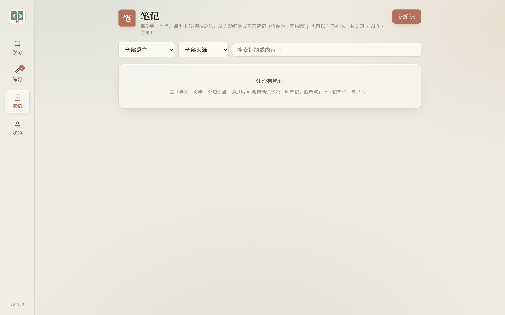 |

**手机 · 单栏 + 底部页签（≤767px 自动切换）**

| 书架 | 讲解（长文上下滑读） | 代码区（切页签不丢内容） | 练习 |
| --- | --- | --- | --- |
| 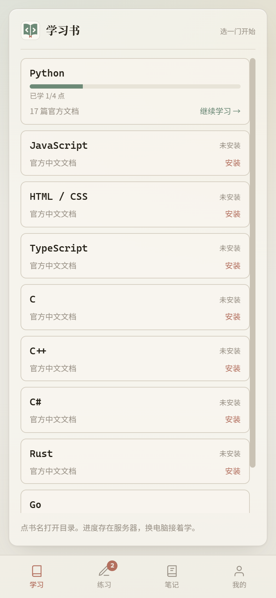 | 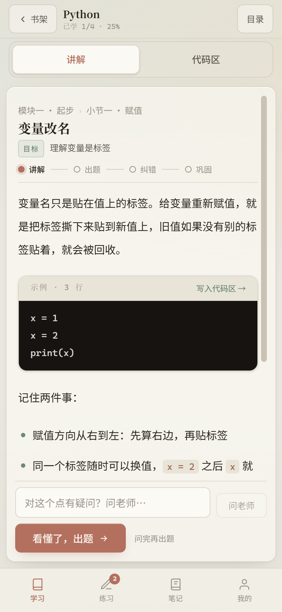 | 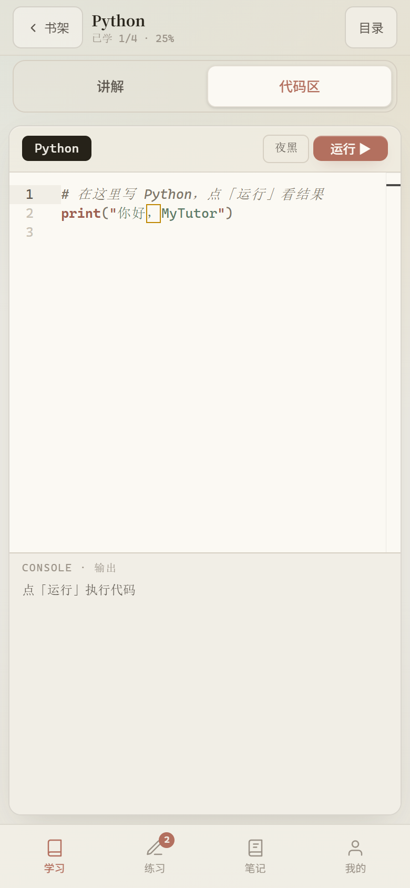 | 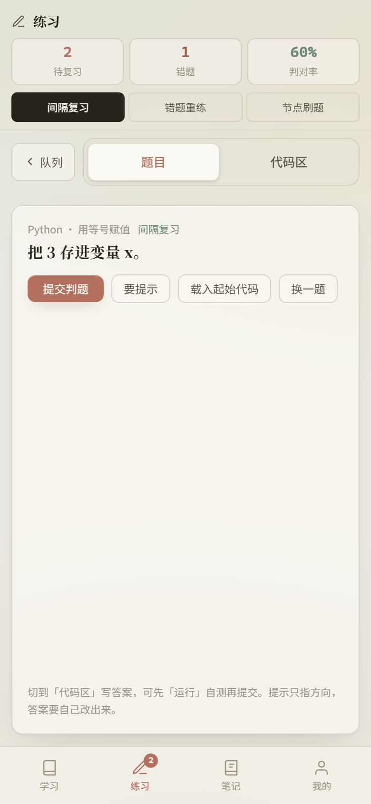 |

## 布局与教学循环

**微知识点教学循环**：一次只学一个最小点，你点按钮才前进。

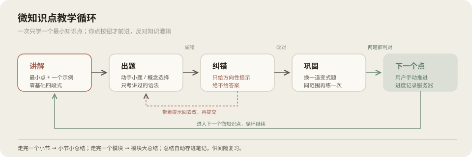

**桌面三栏布局**：左选点 → 中讲透 → 右动手。

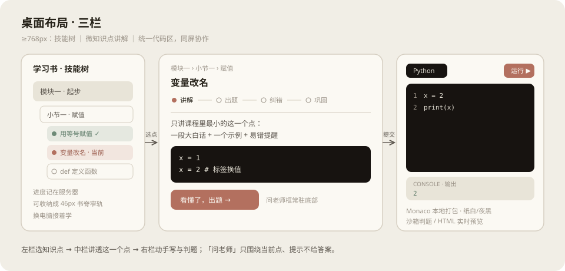

**手机单栏布局**：底部页签 + 讲解/代码区页签 + 目录抽屉；卡头随正文滚动让出阅读高度。

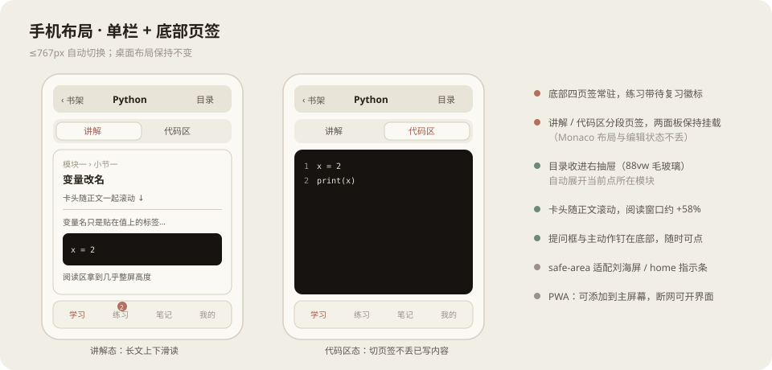

## 架构

```
浏览器 ── React 18 + Vite + Tailwind 4 + Monaco（开发 :5173）
              │ /api
        FastAPI（:8300，server/）
              │ PYTHONPATH 引用
        DeepTutor 引擎（知识库 / RAG / 抓取 / 沙箱）
              │
        data/（设置、语言包、知识库、会话、笔记 —— 不进仓库）
```

- `server/`：独立编写的后端。`teach.py` 教学状态机与提示词，`packs.py` 语言包安装流水线，`kb.py` 引擎 RAG 对接（显式嵌入配置），`notes.py` 笔记存储与 AI 自动笔记，`runner.py` 沙箱执行，`auth.py` 口令 gate。
- `web/`：独立编写的前端。学习页三栏（学习书｜讲解卡｜代码区），笔记页，设置页（模型 / 密钥 / 教学偏好 / 官方资料库折叠区）。
- `deploy/`：Linux 服务器部署参考（systemd 专用用户 + 内存限额 + nginx 子路径反代）。
- `patches/`：DeepTutor v1.7.3 的两处必要本地修复（文档抓取 NO_PROXY 相关）。

## 快速开始

需要：Python 3.12+、Node.js 20+、DeepSeek 与阿里百炼的 API key（在设置页填写）。

```bash
# 1. 引擎：克隆 DeepTutor v1.7.3 并应用修复补丁
git clone --branch v1.7.3 --depth 1 https://github.com/HKUDS/DeepTutor.git
cd DeepTutor && git apply /path/to/mytutor/patches/deeptutor-v1.7.3-fixes.patch && cd ..

# 2. 本仓库
git clone https://github.com/zhouyunfneg/mytutor.git
cd mytutor

# 3. Python 环境（引擎依赖较重，含 llama-index / faiss 等）
python -m venv .venv
.venv/Scripts/pip install -r deploy/requirements-server.txt   # Windows
# source .venv/bin/activate && pip install -r deploy/requirements-server.txt  # Linux/macOS

# 4. 后端（PYTHONPATH 指向引擎与本应用；MYTUTOR_DATA 可选，默认 ./data）
#    Windows PowerShell: $env:PYTHONPATH="..\DeepTutor;."
PYTHONPATH=../DeepTutor:. .venv/bin/python -m uvicorn server.main:app --host 127.0.0.1 --port 8300

# 5. 前端（另开终端）
cd web && npm install && npm run dev
```

打开 http://localhost:5173 ：

1. 「我的」页填 DeepSeek / DashScope 的 API key，点「测对话 / 测嵌入」确认连通；
2. 「学习」页安装语言包（抓取文档 + 建索引 + 生成技能树，几分钟）；
3. 点「开始学习」。未设置口令时为本机开发模式，直接进入。

## 生产部署（参考）

`deploy/install-mytutor.sh` 是在 Ubuntu 24.04 上的实际安装脚本（root 运行）：专用系统用户、venv、systemd 服务（内存限额 600M/1000M）、首次随机口令初始化、bubblewrap 沙箱探测（不可用时回退受限子进程）。nginx 子路径反代示例：

```nginx
location /tutor/ {
    proxy_pass http://127.0.0.1:8300/;   # 剥掉 /tutor 前缀
    proxy_set_header Host $host;
    proxy_set_header X-Forwarded-Proto $scheme;
}
```

前端生产构建 base 为 `/tutor/`（`web/vite.config.js`，按自己的子路径调整），`npm run build` 后由 FastAPI 直接托管 `web/dist`。`deploy/server_check.py` 提供绕过 HTTP 的服务端自检（连通性 / 安装 / 检索 / 教学循环 / 笔记）。

## 版本路线

- **v0.7.1（当前）**：首页语言卡可点进去学 + 示意图残留修复——九张语言介绍卡整张成为学习入口（与学习书共用同一套状态判定：已装直接学 / 未装自动装好再进入 / 安装中看日志 / 失败重试），修掉重复点击会二次发起安装、以及卡片顶行挤爆导致中栏横向溢出两处缺陷；修复 Mermaid 渲染失败时错误图永久残留在页面底部（跨页累积）的问题，图坏仍整卡隐藏、讲解照常。
- **v0.7.0**：手机可用——窄屏（≤767px）单栏移动布局（底部四页签、讲解/代码区分段页签、目录右抽屉），手机讲解区卡头随正文滚动把高度让给阅读；PWA 安装与断网可开界面（Service Worker 绝不缓存 /api）。桌面布局零改动。
- **v0.6.0**：概念点改选择/判断题（2~4 选项，答案只存服务端、提示绝不点明正确选项）；教学页新增「换一题」（换题不换知识点）；判题规则按语言分喂，修复巩固题超纲与旧题 `KeyError: 'options'`。
- **v0.5.0**：零基础精编课程——HTML/CSS 确定性种子主线（8 模块 63 微知识点，每点带先修/为什么/难度/教程出处），讲解改纯零基础四段式；反灌输硬约束由字数改为「最小知识点范围」；示意图改 Mermaid 自动布局（服务端白名单校验 + 色族统一）；精编标记；讲解 Markdown 渲染修复；左下角运行时版本号。
- **v0.4.1**：空态打磨——未选语言时中栏改「语言一览」（九语言各一句话特点，列表跟随服务器语言包）；空态意义不明的"微"字印章换全站品牌 LOGO（与侧栏/登录页同源）。
- **v0.4.0**：教学互动与多语言——课程卡排版重做 + AI 白名单 SVG 示意图；C / C++ / C# / Rust / Go 五语言包与编译运行通道、两阶段判题（单文件约束）；讲解阶段「问老师」师生问答（只围绕当前点、防灌输、留 8 轮）；出题阶段「题目提示」大白话读题（不给答案、不泄漏判题）；书卡去掉冗余"就绪"标签。
- **v0.3.0**：阶段 3——练习题库 + 错题本 + 间隔复习。三模式练习页（间隔复习 / 错题重练 / 节点刷题），按点缓存变式题（每点 6 道封顶），判错自动入本并记一句错因（≤30 字），重练做对自动消除，复习按 1→3→7→15→30 天排期、做错归零，学完一个点自动登记复习，导航待复习徽标。判题与提示沿用防灌输锁：只给方向不给答案。
- **v0.2.0**：体验统一——笔记只记知识点重点；毛玻璃唯一主题 + 手绘 LOGO；学习书书脊式收纳；全站配色纪律（暖纸 + 陶土红 + 灰绿一族，编辑器纸白/夜黑同族）；代码区顶栏窄屏换行。
- **v0.1.0**：阶段 2 完成——四语言包就绪（117 篇官方文档、197 个微知识点），教学全链路真实模型实测通过，笔记 / 学习书 / 毛玻璃界面上线。
- 规划中：报错门诊 / 自由问答。

## 致谢与许可

- 引擎：[DeepTutor](https://github.com/HKUDS/DeepTutor) © HKUDS 及贡献者，Apache-2.0。MyTutor 以库方式引用其 v1.7.3（commit `4c1e000`），未随仓库分发其源码；两处本地修复见 `patches/`。
- 毛玻璃材质规则参考 [solid-glass](https://github.com/deeplethe/solid-glass)（MIT © DeepLethe），配色为本项目自调。
- MyTutor 自身代码 © 2026 zhouyunfneg，Apache-2.0（见 `LICENSE` 与 `NOTICE`）。

> 个人学习项目。AI 讲解与判题可能存在错误，关键细节请以官方文档为准。